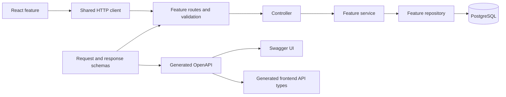

# MealPlanner architecture

This is the shared architecture for frontend and backend contributions. Follow it together with [CONTRIBUTING.md](CONTRIBUTING.md) and [GUIDELINES.md](GUIDELINES.md). Update this document in the same PR whenever the team changes an architectural decision.

## Current implementation and target

The repository contains a React starter, an Express and TypeScript API runtime, PostgreSQL migrations, the Ciqual import, demo data, and a database connection pool. Business modules, authentication, and API documentation are still to be implemented. The structure below defines how new features must be organized.

The trees in this document describe the target structure. Create files when needed by a feature; do not generate empty layers or move existing working code just to match a diagram.

| Area | Decision |
|---|---|
| Frontend | React, TypeScript, and Vite |
| Backend | Node.js 22, TypeScript in strict mode, and Express 5 |
| Database | PostgreSQL 16, existing SQL migrations, and `pg` |
| Request contracts | Zod schemas with inferred TypeScript types |
| API documentation | OpenAPI generated with `@asteasolutions/zod-to-openapi`, displayed with `swagger-ui-express` |
| Backend tests | Node.js test runner through `tsx`, with Supertest for HTTP tests |
| Authentication | JWT, as specified in [SCRUM-39](https://edgarandre.atlassian.net/browse/SCRUM-39); token transport, expiry, and refresh behavior must be documented before implementation |
| Language | English for code identifiers, documentation, branch names, and commit messages |

Keep the current ES module setup. Backend imports must remain compatible with `NodeNext` and the TypeScript build. Do not add an ORM or replace the existing migrations as part of API setup.

## Organize by feature

Both applications use the same domain names: `auth`, `users`, `ingredients`, `recipes`, `meal-plans`, `shopping-lists`, and `nutrition`. Add a frontend feature only when it has a user-facing responsibility.

Each feature owns its implementation. Shared infrastructure contains reusable technical code, not a second home for feature logic. Keep cross-feature dependencies explicit, small, and free of cycles.



## Frontend structure

```text
front/src/
  main.tsx
  app/
    App.tsx
    routes.tsx
    providers.tsx
  features/
    recipes/
      api/recipes.api.ts
      components/
      hooks/
      pages/
      recipes.types.ts
      index.ts
    auth/
    ingredients/
    meal-plans/
    shopping-lists/
    nutrition/
  shared/
    api/
      client.ts
      api-error.ts
      generated/
    ui/
    lib/
    styles/
```

- `app/` assembles navigation, page routes, layout, and application-wide providers. The current root `App.tsx` can move here when the application shell is introduced; update its import in `main.tsx` in that PR.
- `features/<feature>/api/` contains that feature's HTTP calls using the shared client. Components do not call `fetch` directly.
- `components/` contains feature UI; `pages/` contains page-level composition; `hooks/` contains React behavior and data loading. Keep loading, empty, success, and error states explicit.
- `recipes.types.ts` contains UI-specific types. API request and response types come from the generated API contract, not copies of database entities.
- `shared/api/client.ts` handles the API base URL, common headers, request cancellation, and normalization of API errors. Authentication attaches credentials through this layer; individual features must not invent their own token handling.
- `shared/ui/` contains components already needed by more than one feature. Do not move a recipe-specific component there just because another feature might need it later.
- Use feature-local CSS Modules for new component styles. Global styles are reserved for resets, typography, and design tokens to avoid selector collisions.

### Frontend dependency rules

- `app/` may import feature public exports and `shared/`.
- A feature may import its own files and `shared/`.
- Features must not import another feature's internal files. Compose cross-feature screens in `app/`, passing data and callbacks through props or explicit public interfaces.
- `shared/` must not import from `features/` or `app/`.
- Keep component state local until a real cross-feature need exists. Select new routing, form, or state libraries in a shared foundation PR before individual features depend on them.
- The frontend never imports backend source files, database models, or SQL. Client validation improves usability; server validation and authorization remain authoritative.

## Backend structure

```text
back/
  src/
    app.ts
    server.ts
    config/env.ts
    db/pool.ts
    docs/openapi.ts
    modules/
      health/
      auth/
      users/
      ingredients/
      recipes/
        recipes.routes.ts
        recipes.controller.ts
        recipes.service.ts
        recipes.repository.ts
        recipes.schemas.ts
        recipes.contract.ts
        index.ts
      meal-plans/
      shopping-lists/
      nutrition/
    shared/
      http/
        api-error.ts
        validate.ts
        error-handler.ts
        not-found.ts
        auth-context.ts
      logging/
  tests/
    integration/
    fixtures/
  scripts/
  migrations/
  data/
```

| Layer | Responsibility | Must not contain |
|---|---|---|
| Routes | Declare HTTP methods, paths, validation, and authentication middleware | SQL or business rules |
| Controller | Read validated input and authenticated identity; map service results to HTTP responses | Database queries or business calculations |
| Service | Execute use cases, enforce ownership and business rules, coordinate repositories and transactions | Express `Request` or `Response` objects |
| Repository | Run parameterized SQL and map database rows | HTTP status handling or UI concerns |
| Schemas | Define public input and output shapes; infer their TypeScript types | Database connection or server startup |
| Contract | Reference schemas and declare method, path, responses, security, tags, and descriptions | Business implementation |
| Public `index.ts` | Export the module's router, contract registration, and intentionally shared service interfaces | Automatic exports of every internal file |

Keep controllers thin. A small endpoint does not need extra abstraction layers if there is no business logic to separate, but all SQL still belongs in a repository.

### Application assembly

- `app.ts` creates and configures an Express application and mounts feature routers. It must not call `listen`, run migrations, import Ciqual, or seed data.
- `server.ts` loads validated runtime configuration, starts listening, and handles graceful shutdown of the HTTP server and existing PostgreSQL pool.
- `config/env.ts` validates runtime variables once. Never require production credentials merely to generate OpenAPI or run isolated unit tests.
- Register JSON parsing, CORS, and request logging before feature routes; register the not-found middleware and error handler after them.
- Keep `src/db/pool.ts` as the shared database connection entry point. Feature repositories reuse it; they do not create independent pools.
- Keep migrations, data imports, and seeds as explicit commands. Starting the API must not mutate or reset the schema.

### Backend dependency and data ownership rules

Services may use another module's documented public service interface. They may not import its controller or repository. Avoid cycles; extract a small shared type or coordinate the use case in the consuming feature instead of importing across layers.

| Module | Owned data or responsibility |
|---|---|
| `health` | Process liveness and database readiness; no domain data |
| `users` | User records and persistence; never expose `password_hash` in API responses |
| `auth` | Credential verification and JWT authentication, using the users module's public interface |
| `ingredients` | Ingredient catalog, searches, and unit weights |
| `recipes` | Recipes, ingredient quantities, steps, favorites, and recipe-related badges when implemented |
| `meal-plans` | Planned meals and their association with user-owned recipes |
| `shopping-lists` | Shopping lists, items, and the generation use case |
| `nutrition` | Reading the existing nutrition views and presenting nutrition results |

Each table has one write owner. Read models that join domains or use existing database views must be explicit and reviewed. Do not bypass ownership checks simply because a join is convenient. Nutrition calculations already implemented by database views remain the source of truth; do not duplicate them in React or a second backend calculation.

For multi-step writes, the service coordinates one transaction and passes the same `pg` client to participating repositories. Do not issue `BEGIN` on one connection and continue queries on another pool connection.

## API contract and documentation

Application endpoints use `/api`, matching the existing Jira backlog, for example `/api/recipes` and `/api/meal-plans`. Infrastructure endpoints use `/health` and `/ready`; documentation uses `/docs` and `/openapi.json`.

- Define Zod request and response schemas once in the owning feature. Infer TypeScript types from those schemas.
- Define endpoint metadata once in the feature contract. Routing and documentation must consume the same method/path constants and schemas rather than copy them independently.
- Explicitly declare descriptions, status codes, examples, and authentication requirements. TypeScript alone does not generate a complete OpenAPI contract.
- `docs/openapi.ts` assembles feature contracts. A `docs:generate` script produces OpenAPI without starting the server or connecting to PostgreSQL.
- Serve the generated document through `/openapi.json` and Swagger UI through `/docs`. Generated output is never edited manually.
- Generate frontend API types from OpenAPI into `front/src/shared/api/generated/` when the first frontend API integration is added. Until then, describe proposed request/response shapes in the contract PR instead of creating competing type definitions.
- Record contract changes in the PR before consumers start implementing against them. Preserve existing fields or coordinate breaking changes with both consumers and producers.

References: [Zod to OpenAPI](https://github.com/asteasolutions/zod-to-openapi), [Swagger UI Express](https://github.com/scottie1984/swagger-ui-express), and [Express error handling](https://expressjs.com/en/guide/error-handling/).

### Wire format conventions

- Use camelCase for JSON fields and snake_case for database columns; map explicitly at the backend boundary.
- UUID identifiers are JSON strings. Date-only meal planning fields use `YYYY-MM-DD`; timestamps use ISO 8601 with an explicit timezone.
- Repositories must handle PostgreSQL `numeric` values deliberately rather than assume `pg` returns JavaScript numbers. Public numeric fields must match their documented JSON schema.
- A single-resource response uses `{ "data": { ... } }`. A paginated list uses `{ "data": [], "pagination": { "page": 1, "pageSize": 20, "total": 0 } }`.
- Lists use `page` and `pageSize`, defaulting to 1 and 20, with `pageSize` limited to 100. Document any endpoint that uses a different pagination model.
- Errors use `{ "error": { "code": "VALIDATION_ERROR", "message": "Invalid request.", "details": [] } }`. Validation details identify public fields; responses never expose SQL, stack traces, or secrets.
- Use 400 for invalid input, 401 for missing or invalid authentication, 403 for forbidden operations, 404 for missing resources, 409 for business conflicts, and 500 for unexpected failures. Private-resource lookups may consistently return 404 for another user's resource to avoid disclosing its existence.
- For private operations, derive the user ID from verified authentication. A `userId` supplied by the client does not establish ownership.
- CORS is a browser integration setting, not authentication or authorization.

## Parallel work without overlapping ownership

Folder boundaries reduce conflicts but cannot eliminate them. Each ticket and PR must state its feature folder, shared files touched, API contract changes, and dependencies.

| Work area | Coordination rule |
|---|---|
| `front/src/features/<feature>/`, `back/src/modules/<feature>/` | The feature contributor owns changes inside that module |
| `app.ts`, `server.ts`, `front/src/app/`, `main.tsx` | Coordinate with the foundation/application-shell contributor; keep registration changes small |
| Shared HTTP client, errors, authentication context, global styles | Agree on the contract first; merge a small shared change before dependent features |
| `package.json`, `package-lock.json`, TypeScript configuration | Add dependencies in a focused PR; do not resolve lockfile conflicts by copying arbitrary sections |
| `migrations/` | Reserve the next migration number in the ticket before implementation; coordinate concurrent schema changes |
| Generated routes, API types, or documentation | Regenerate after integrating source changes; do not hand-merge generated files |
| This document and API-wide conventions | Review with contributors affected by the change |

Start working branches from an up-to-date `dev`, preferably naming them with the Jira key, for example `feat/scrum-17-recipes-api`. Synchronize with `dev` before final review. If a PR must support GitHub's automatic rebase, resolve conflicts through a local rebase and publish with a lease; GitHub's **Resolve conflicts** action creates a merge commit and does not resolve every possible rebase conflict.

Do not merge an unfinished foundation into each feature in different ways. Merge the shared foundation first, then let each feature consume its stable public interfaces. A feature must not replace another module's files or recreate a shared helper under a new name.

### Feature contribution checklist

1. Check the Jira ticket, dependencies, and reserved migration number.
2. Agree on request/response schemas and cross-module public interfaces.
3. Implement inside the owning feature folders; coordinate shared edits separately.
4. Add relevant service or HTTP tests, including ownership checks for private data.
5. Regenerate OpenAPI and affected frontend API types.
6. Run the relevant build, type checks, and tests, then open a focused PR into `dev`.

## Tests and delivery

Keep pure service tests beside their module as `*.test.ts`. HTTP and PostgreSQL integration tests belong in `back/tests/integration/`. Frontend component and hook tests stay beside their feature code when a test runner is introduced.

Export the Express app separately so HTTP tests can run without opening a production listening port. Database integration tests use a dedicated test database, apply the real migrations, and insert small fixtures. They must never reset a developer's normal database or import the full Ciqual catalog unnecessarily.

Backend foundation work must add `dev`, `build`, `start`, `test`, and `docs:generate` scripts while preserving existing database commands. CI must check TypeScript, compile the backend, generate OpenAPI, and run backend tests alongside the existing frontend build. Test failures or a failed contract generation must fail the corresponding CI job.

